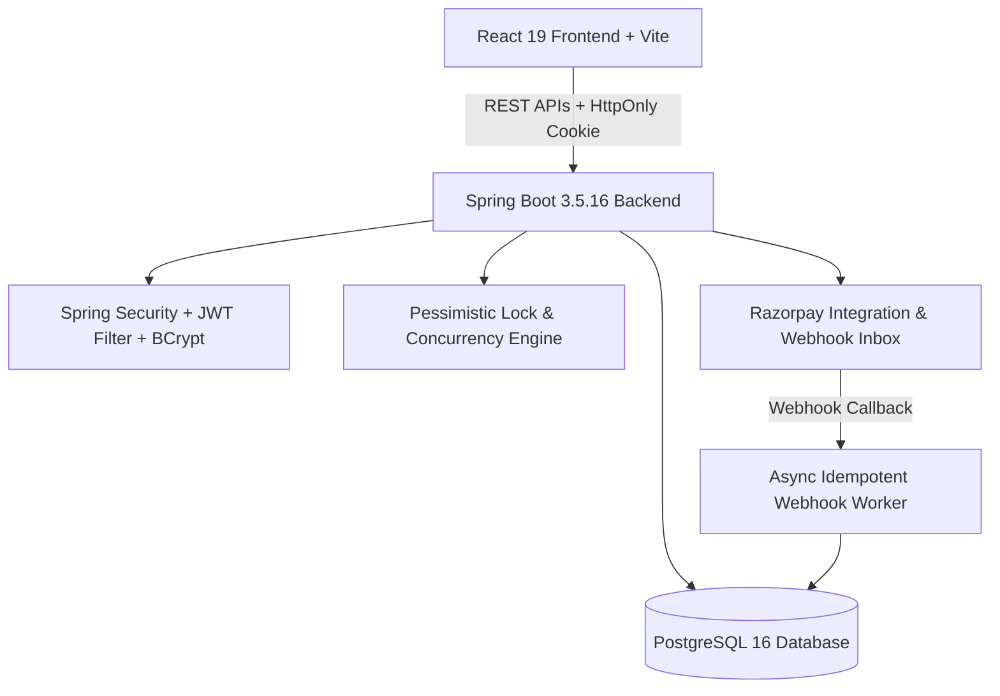

# 🌸 CampusShare — Peer-to-Peer Campus Marketplace

[](https://openjdk.org/)
[](https://spring.io/projects/spring-boot)
[](https://react.dev/)
[](https://vitejs.dev/)
[](https://www.postgresql.org/)
[](https://spring.io/projects/spring-security)
[](https://banasthali.org/)
[]()

> **CampusShare** is a full-stack, placement-ready peer-to-peer rental and buy/sell marketplace tailored for the **Banasthali Vidyapith** university ecosystem. It allows students to list items, rent academic essentials (calculators, lab gear, bicycles, hostel utilities), manage rental lifecycles, process secure payments via Razorpay integration architecture, perform PIN-verified physical handovers at campus hotspots, and maintain an immutable ledger of transaction history.

---

## 🌟 Key Engineering Highlights

- **Concurrency-Safe Rental Booking**: Protects against race conditions and double-booking collisions by combining database pessimistic row locks (`SELECT ... FOR UPDATE`) during rental acceptance with JPA optimistic versioning on listings.
- **Authoritative Server-Side Pricing Engine**: Zero-trust client calculation; Spring Boot independently computes and validates rental durations, daily rates, campus service fees, and refundable security deposits.
- **Robust Payment Architecture**: Full Razorpay checkout lifecycle including server-created Razorpay Orders, HMAC-SHA256 signature verification, and an idempotent durable webhook inbox with asynchronous retry processing.
- **Stateless Authentication with Token Rotation**: Short-lived JWT access tokens paired with rotating SHA-256 refresh tokens in secure HttpOnly cookies, full session revocation, and BCrypt password encryption.
- **Physical Trust & Double Confirmation**: 6-digit secure handover PIN revealed to the owner only upon captured payment, followed by mutual two-sided return confirmation to release security deposits.
- **Production Database Discipline**: PostgreSQL 16 schema managed via Flyway versioned migrations (`V1__startup_schema.sql`) with strict Bean validation boundaries.

---

## 🏗️ System Architecture & Data Flow



| Layer | Technologies |
| :--- | :--- |
| **Frontend** | React 19, Vite 7, React Router 7, Axios, Modern Responsive CSS |
| **Backend** | Java 21, Spring Boot 3.5.16, Spring Security, Spring Data JPA, Hibernate |
| **Authentication** | JWT (jjwt 0.12.6), BCrypt Password Hashing, Rotating HttpOnly Refresh Tokens |
| **Database & Migrations** | PostgreSQL 16 (Production), H2 PostgreSQL-mode (Local Test), Flyway |
| **Payments** | Razorpay Order Creation, Signature Verification, Durable Webhook Inbox |
| **DevOps & Containerization** | Docker, Docker Compose, Nginx Reverse Proxy, GitHub Actions CI |

---

## 🔄 End-to-End Rental Lifecycle

```text
1. Student Signup / Login
   └─> Banasthali department association -> JWT + HttpOnly rotating refresh cookie

2. Listing & Discovery
   └─> Owner lists item -> Borrower selects rental date range -> Backend validates no overlaps

3. Rental Request Acceptance
   └─> Database row-lock prevents competing concurrent accepts -> 6-digit handover PIN generated

4. Secure Payment (Razorpay Architecture)
   └─> Backend creates Razorpay Order -> Borrower pays -> HMAC verified -> Webhook reconciles payment

5. Physical Handover at Campus Spot
   └─> Owner shares 6-digit PIN at Central Library / Hostel Gate -> Borrower enters PIN -> Rental becomes ACTIVE

6. Return & Deposit Settlement
   └─> Borrower confirms returned -> Owner confirms received -> Rental COMPLETED -> Security deposit released
```

---

## 📁 Repository Structure

```text
campus-share-project-/
├── .github/workflows/ci.yml      # Continuous Integration Pipeline
├── campusshare-backend/
│   ├── src/main/java/com/campusshare/
│   │   ├── config/               # Security, WebConfig, OpenAPI & Async config
│   │   ├── controller/           # Item, Rental, Payment, Auth REST Controllers
│   │   ├── dto/                  # Validated Request/Response DTOs
│   │   ├── model/                # JPA Entities (User, Item, Rental, PaymentLedger)
│   │   ├── repository/           # Spring Data JPA Repositories
│   │   ├── security/             # JWT Filter, Authentication Provider, Token Service
│   │   └── service/              # Core business services & locking logic
│   ├── src/main/resources/
│   │   ├── db/migration/         # Flyway versioned database migration scripts
│   │   ├── application.yml       # Base configuration
│   │   └── application-prod.yml  # Production PostgreSQL configuration
│   ├── src/test/                 # 23 JUnit 5 unit & service tests
│   ├── .env.example              # Environment variables template
│   └── pom.xml
├── campusshare-frontend/
│   ├── src/                      # React 19 Components, Pages, State Management
│   ├── Dockerfile
│   └── package.json
├── docker-compose.yml            # Multi-container orchestration (PostgreSQL + App + Nginx)
└── README.md
```

---

## ⚡ Getting Started Locally

### Prerequisites
- **Java Development Kit (JDK)**: Version 21
- **Apache Maven**: Version 3.9+
- **Node.js**: Version 18+ (Node 20/22 LTS recommended) & npm

---

### Option 1: Manual Run (Development)

**1. Start Backend:**
```bash
cd campusshare-backend

# Run test suite
mvn test

# Launch backend (defaults to local H2 PostgreSQL-mode)
mvn spring-boot:run
```
> Backend API: `http://localhost:8080`  
> Swagger OpenAPI Docs: `http://localhost:8080/swagger-ui.html`

**2. Start Frontend:**
```bash
cd campusshare-frontend

# Install dependencies
npm ci

# Start Vite dev server
npm run dev
```
> Frontend Application: `http://localhost:5173`

---

### Option 2: Docker Compose (Full Stack with PostgreSQL)

```bash
# Build and spin up PostgreSQL, Spring Boot, and Nginx React frontend
docker compose up --build
```
> Full application will be available at: `http://localhost:5173`

---

## 💳 Payment Integration & Architecture

> **Payment Capability Note**:  
> The application includes complete Razorpay integration architecture and can process Test/Live payments when valid Razorpay credentials, webhook configuration, and an approved account are supplied.

### Key Payment Safety Features:
- Orders are generated on the server for the exact calculated price in paise.
- Browser checkout callbacks are validated against the server-stored Order ID and Secret HMAC signature.
- Webhook events are captured into a durable database inbox before processing, ensuring no lost payment notifications even during transient network or server downtime.

---

## 🎯 Technical Interview Discussion Points

1. **How is double-booking prevented during concurrent rental requests?**
   - The rental acceptance query executes with pessimistic locking (`PESSIMISTIC_WRITE`), obtaining an exclusive row lock on the item record. Concurrent acceptance requests for overlapping dates are blocked and rejected at the database level before any state transition occurs.
2. **Why use an Idempotent Webhook Inbox for payments?**
   - Webhooks can arrive multiple times or out of order due to network retries. By storing raw event IDs in a unique-keyed inbox table, CampusShare acknowledges receipt immediately (`200 OK`) and processes events idempotently in the background without duplicate balance or deposit releases.
3. **How does the authentication architecture protect user tokens?**
   - Access tokens are short-lived (15 minutes) and stored in memory, while refresh tokens are stored in `HttpOnly`, `SameSite=Strict` cookies. When a refresh token is used, it is rotated and old refresh tokens are invalidated in the database to detect and prevent token reuse attacks.

---

## 📄 License
This project is licensed under the **MIT License**.