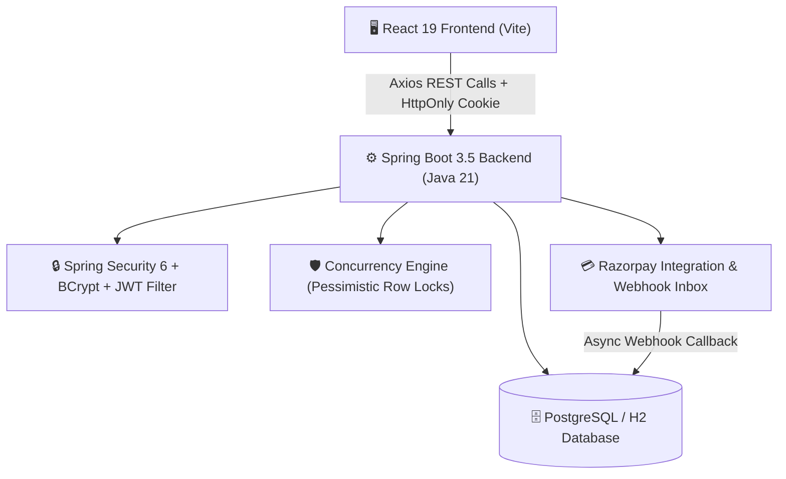

# 🌸 CampusShare — Banasthali Vidyapith P2P Student Marketplace

[](https://openjdk.org/)
[](https://spring.io/projects/spring-boot)
[](https://react.dev/)
[](https://vitejs.dev/)
[](https://spring.io/projects/spring-security)
[](https://banasthali.org/)
[]()

> **CampusShare** is a full-stack, placement-ready peer-to-peer (P2P) campus rental and marketplace platform built exclusively for the **Banasthali Vidyapith** student community. Students can rent or buy academic essentials (scientific calculators for AIM & ACT lab exams, lab aprons, cycles for hostel commutes, books, sports gear) directly from peers with **zero delivery delays**, **transparent pricing**, and **safe in-person handovers**.

---

## 📖 Table of Contents
- [Why CampusShare? (Problem & Solution)](#-why-campusshare-problem--solution)
- [Key Features](#-key-features)
- [System Architecture](#-system-architecture)
- [Tech Stack](#-tech-stack)
- [How the Rental Flow Works (Step-by-Step)](#-how-the-rental-flow-works-step-by-step)
- [Quick Start Guide (Run Locally in 3 Steps)](#-quick-start-guide-run-locally-in-3-steps)
- [Demo Test Accounts](#-demo-test-accounts)
- [Project Directory Structure](#-project-directory-structure)
- [Placement & Interview Highlights](#-placement--interview-highlights)
- [License](#-license)

---

## 💡 Why CampusShare? (Problem & Solution)

### ❌ The Campus Problem:
- Students buy expensive items (scientific calculators, lab coats, cycles, mattress) that are only needed for **a few days or one semester**.
- Buying brand new creates **financial waste** and **hostel room clutter**.
- Open marketplaces (OLX/Quikr) are unsafe for college students and involve courier fees and strangers.

### ✅ The CampusShare Solution:
- **Campus-Exclusive**: Only verified students with campus identity (`@banasthali.in` / hostel verification).
- **Same-Day Handover**: Meet directly at campus hotspots (Central Library Gate, Shakuntala Canteen, Hostels).
- **Zero Fraud**: Protected by **6-Digit Handover PINs**, **Pessimistic Database Locking** (no double bookings), and **Refundable Security Deposits**.

---

## ✨ Key Features

| Feature | Description |
| :--- | :--- |
| 🔒 **Rock-Solid Security** | Passwords hashed using **BCrypt (cost 12)**. Dual-token authentication with short-lived **JWT Access Tokens** + **Rotating HttpOnly Refresh Cookies** (immune to XSS attacks). Strict **IDOR protection** on all endpoints. |
| ⚡ **Zero-Trust Pricing** | All prices, daily/weekly rates, 5% platform fees, and deposits are computed **authoritatively on the Spring Boot backend**. Clients cannot tamper with prices. |
| 🛡️ **Race-Condition & Overlap Safe** | Uses **Pessimistic Database Write Locking** (`SELECT ... FOR UPDATE`) so two students cannot book the same item for overlapping dates at the same second. |
| 💳 **Razorpay & Cash Settlement** | Complete payment architecture with server-side order generation, **HMAC-SHA256 signature verification**, and **Durable Idempotent Webhook Inbox**. Also supports in-person peer cash/UPI confirmation. |
| 🤝 **6-Digit Handover PIN** | A cryptographically secure PIN (`SecureRandom`) is generated on payment. The owner shares the PIN only during in-person physical handover, guaranteeing proof of delivery. |
| 🔄 **Dual-Confirmation Return** | Borrower confirms return $\rightarrow$ Owner inspects item & confirms receipt $\rightarrow$ Status becomes `COMPLETED` $\rightarrow$ Security deposit is automatically refunded. |
| 🌸 **Banasthali Vidyapith Tailored** | Integrated hostel blocks (*Gargi, Shakuntala, Maitreyi, Kasturba, Yashoda, Sharda, etc.*) and academic pickup spots (*Central Library Gyan Mandir Gate, AIM & ACT Building, Surya Mandir*). |
| 🤖 **Explainable Smart Feed** | Multi-factor composite scoring ranks listings by student intent, owner reputation ($\ge 4.5\star$), demand, and listing freshness with human-readable recommendation chips. |

---

## 🏗️ System Architecture



---

## 🛠️ Tech Stack

```text
┌─────────────────┬────────────────────────────────────────────────────────┐
│ Frontend        │ React 19, Vite 7, React Router 7, Axios, Responsive CSS│
│ Backend         │ Java 21, Spring Boot 3.5.16, Spring Security 6         │
│ Data & ORM      │ Spring Data JPA, Hibernate ORM, Flyway Migrations       │
│ Database        │ PostgreSQL 16 (Production) / H2 DB (Local Development) │
│ Payments        │ Razorpay API (Orders, Signatures, Idempotent Webhooks) │
│ DevOps & CI/CD  │ Docker, Docker Compose, Nginx, GitHub Actions CI       │
└─────────────────┴────────────────────────────────────────────────────────┘
```

---

## 🔄 How the Rental Flow Works (Step-by-Step)

```text
1. 👤 Student Signs Up
   └─ Selects Banasthali Hostel & Department -> Logs in with JWT + HttpOnly Cookie

2. 📦 Owner Lists an Item
   └─ Sets daily rate, weekly discount, and optional refundable security deposit

3. 📅 Borrower Requests Booking
   └─ Picks dates -> Backend checks for date collisions -> Owner accepts request

4. 💳 Payment & Security Deposit
   └─ Borrower pays online via Razorpay (or marks direct cash/UPI) -> Status updates to PAID

5. 🔑 Safe Physical Handover
   └─ Both meet at Central Library Gate -> Owner reveals 6-digit PIN -> Borrower enters PIN -> Rental ACTIVE!

6. 🔁 Return & Deposit Refund
   └─ Borrower returns item -> Owner confirms condition -> Rental COMPLETED -> Deposit refunded
```

---

## ⚡ Quick Start Guide (Run Locally in 3 Steps)

### 📋 Prerequisites
Make sure you have these installed on your system:
- **Java JDK 21** or higher (`java -version`)
- **Node.js 18+** / 20+ (`node -v`)
- **Apache Maven** (`mvn -v`)

---

### 🚀 Step 1: Clone the Repository
```bash
git clone https://github.com/123angmish/campus-share-project-.git
cd campus-share-project-
```

---

### 🚀 Step 2: Start the Backend (Spring Boot)
Open a terminal and run:
```bash
cd campusshare-backend
mvn spring-boot:run
```
- **Backend API**: `http://localhost:8080`
- **Health Endpoint**: `http://localhost:8080/actuator/health`
- **API Documentation**: `http://localhost:8080/swagger-ui.html`

---

### 🚀 Step 3: Start the Frontend (React + Vite)
Open a **new second terminal** and run:
```bash
cd campusshare-frontend
npm install
npm run dev -- --port 3000
```
- **Frontend App**: Open **`http://localhost:3000`** in your browser!

---

### 🐳 Option B: Run with Docker Compose (1-Command Full Stack)
If you have Docker installed:
```bash
docker compose up --build
```
This automatically boots PostgreSQL, Spring Boot Backend, and Nginx React Frontend!

---

## 👥 Demo Test Accounts

You can test the marketplace using these pre-seeded demo credentials (or create your own account via Signup):

| Role / Perspective | Email | Password | Department & Hostel |
| :--- | :--- | :--- | :--- |
| **Student Borrower** | `student1@banasthali.in` | `Password@123` | AIM & ACT · Gargi Hostel |
| **Student Lender** | `student2@banasthali.in` | `Password@123` | WISDOM · Shakuntala Hostel |
| **Campus Admin** | `admin@banasthali.in` | `Admin@123` | Platform Moderator |

---

## 📁 Project Directory Structure

```text
campus-share-project-/
├── .github/workflows/ci.yml       # Automated GitHub Actions CI (Test & Lint)
├── campusshare-backend/           # Spring Boot 3.5 Java Backend
│   ├── src/main/java/com/campusshare/
│   │   ├── config/                # Security, CORS & Swagger OpenAPI config
│   │   ├── controller/            # REST API endpoints (/api/items, /api/rentals, /api/auth)
│   │   ├── dto/                   # Request & Response Data Transfer Objects
│   │   ├── model/                 # JPA Entities (User, Item, RentalTransaction, Payment)
│   │   ├── repository/            # Spring Data JPA database interfaces
│   │   ├── security/              # JWT Filter, BCrypt encoder & user details
│   │   └── service/               # Business logic, locking & Razorpay engine
│   ├── src/main/resources/
│   │   ├── db/migration/          # Flyway SQL schema scripts
│   │   └── application.yml        # Backend application configuration
│   └── pom.xml                    # Maven project dependencies
├── campusshare-frontend/          # React 19 Frontend Application
│   ├── src/
│   │   ├── components/            # Navbar, Modals, ImageUploader, NotificationDropdown
│   │   ├── context/               # AuthContext & global state hooks
│   │   ├── pages/                 # Home, Login, Signup, CreateItem, Dashboard, History
│   │   └── config/api.js          # Axios client with automatic token refresh interceptor
│   └── package.json               # Frontend dependencies & scripts
├── docker-compose.yml             # Docker multi-container setup
└── README.md                      # Project documentation
```

---

## 🎯 Placement & Interview Highlights

When explaining this project to interviewers, here are the key engineering highlights:

1. **How do you prevent double-booking when 2 students click "Book" at the same second?**
   - *"We use **Pessimistic Database Write Locks** (`@Lock(LockModeType.PESSIMISTIC_WRITE)` / `SELECT ... FOR UPDATE`) in Spring Data JPA combined with date interval intersection checks (`start_date < requested_end AND end_date > requested_start`). The second request waits for the lock and gets cleanly rejected."*

2. **Why use HttpOnly Cookies for Refresh Tokens instead of localStorage?**
   - *"Tokens stored in `localStorage` can be stolen via **Cross-Site Scripting (XSS)**. `HttpOnly` cookies cannot be accessed by browser JavaScript, completely safeguarding session credentials."*

3. **What is Zero-Trust Client Pricing?**
   - *"The frontend never passes the calculated total rent to the backend. Spring Boot recalculates the exact price server-side from the database daily rate, rental days, platform fee, and deposit, preventing price tampering."*

4. **Why is the 6-Digit Handover PIN important?**
   - *"It acts as physical proof-of-delivery. The PIN is generated with cryptographic `SecureRandom` and revealed only to the owner. The borrower enters it on physical collection, eliminating disputes about whether the item was handed over."*

---

## 📄 License
This project is open-sourced under the **MIT License**.

---

<div align="center">
  <sub>Built with ❤️ for <b>Banasthali Vidyapith</b> · Placement-Ready Engineering Project</sub>
</div>
