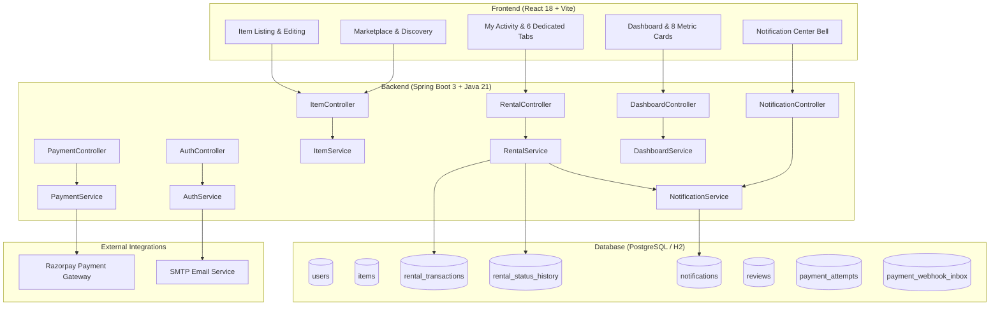

# CampusShare — System Architecture & Data Flow

---

## 🏛️ Key Entities & Relationships

| Entity | Description | Key Relationships |
| :--- | :--- | :--- |
| `User` | Campus student or admin member | Owns multiple `Item`s, acts as borrower or owner on `RentalTransaction`s |
| `Item` | Rented or sold campus item | Belong to `owner` (`User`), has condition, location, prices, date limits |
| `RentalTransaction` | P2P rental or direct purchase record | Links `borrower`, `owner`, and `item`. Tracks status, payment, handover PIN, and deposit refund |
| `RentalStatusHistory` | Immutable audit log of status transitions | Links to `RentalTransaction`, records `fromStatus`, `toStatus`, `changedBy`, and `note` |
| `Notification` | In-app notification for users | Linked to target `User`, has type, title, message, link, and read flag |
| `Review` | Two-way peer trust review | Linked to `RentalTransaction`, `reviewer`, `reviewee`, rating (1-5), comment |
| `PaymentAttempt` | Razorpay order & capture tracking | Linked to `RentalTransaction`, order ID, payment ID, amount in paise, status |
